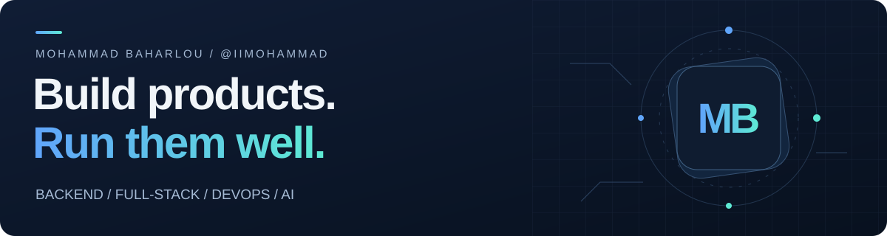

  

# Hi, I'm Mohammad Baharlou

**Backend & Full-Stack Developer · DevOps · AI Integration**

I build web products and the infrastructure that runs them. My work connects Django APIs, Next.js interfaces, background jobs, and AI agents with deployment, monitoring, and backups.

I work across education, commerce, customer communication, and business operations, with a focus on useful products that are straightforward to maintain.

[Explore Goftogohub](https://goftogohub.ir) · [DevOps & server support](https://negahbanweb.ir) · [Public repositories](https://github.com/iimohammad?tab=repositories)

## What I work on

- **Backend systems:** REST APIs, authentication, business workflows, payments, and third-party integrations.
- **Full-stack products:** React and Next.js dashboards, admin panels, and Persian / RTL interfaces.
- **AI integration:** conversational agents, knowledge retrieval, website chat widgets, and messaging workflows.
- **Operations:** Docker deployments, Linux servers, self-hosted CI runners, monitoring, and backup / restore workflows.

## Products I work on

| Product | Focus | Explore |
| --- | --- | --- |
| **Goftogohub** | Instagram DM and comment automation, with AI sales agents. | [goftogohub.ir](https://goftogohub.ir) |
| **Negahbanweb** | Linux server management, deployment, CI/CD, monitoring, and backups. | [negahbanweb.ir](https://negahbanweb.ir) |
| **Medicalstus** | Education tools for study planning, tracking, and exams. | [app.medicalstus.ir](https://app.medicalstus.ir) |
| **Boofe** | An educational social platform for students, with questions, quizzes, and group interaction. | [boofetime.ir](https://boofetime.ir) |

My other product work includes **GameStreet** for commerce, **PrimeCRM** for customer operations, and **Hesabdari** for accounting and inventory.

## Tools I use

| Area | Stack |
| --- | --- |
| Backend | Python · Django · Django REST Framework |
| Frontend | TypeScript · JavaScript · React · Next.js |
| Data | PostgreSQL · Redis · pgvector |
| Async & realtime | Celery · RabbitMQ · Django Channels · WebSockets |
| Infrastructure | Linux · Docker · Docker Compose · Nginx |
| Delivery | Git · GitHub Actions · Self-hosted runners |

My earlier work includes real-time signal processing with **C++ and Qt**.

## Public work

**[GitHub Self-Hosted Runner Operations Toolkit](https://github.com/iimohammad/github-runner-operations-bundle)**  
Bash scripts and Persian documentation for installing and operating GitHub Actions runners on Ubuntu, including service recovery, Docker setup, cleanup, and troubleshooting.

## Work with me

I work on backend development, full-stack products, AI integrations, and deployment automation.

For **AI sales and messaging automation**, visit [Goftogohub](https://goftogohub.ir).  
For **deployment and server operations**, visit [Negahbanweb](https://negahbanweb.ir).
